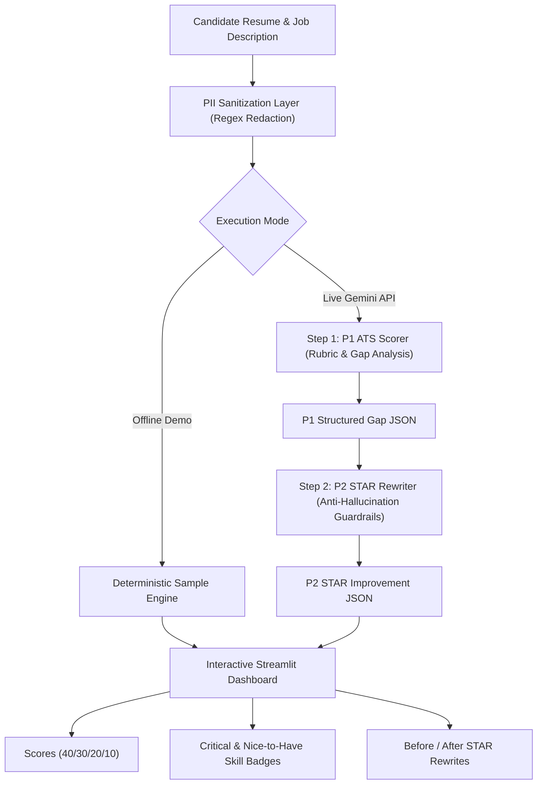

# AlignCV — Intelligent Resume Feedback & Job Alignment Assistant

**SCSE4041 Prompt Engineering Mini-Project (Problem ID: C9)**  
**Team ID:** PE-B81-44 | **Team:** PromptLab | **Batch:** 90

---

## 1. Project Introduction
**AlignCV** is an AI-powered resume evaluation and job alignment assistant. It addresses the common challenge job seekers face: applicant tracking systems (ATS) and recruiters discarding resumes due to unstructured phrasing, unquantified achievements, and missing keywords.

AlignCV decomposes resume evaluation into a deterministic **2-step prompt engineering chain**:
1. **Prompt 1 (`P1` - ATS Skill-Gap & Rubric Scorer):** Scores the resume against a target job description using a strict 100-point weighted rubric, isolates critical missing competencies from nice-to-have skills, and evaluates overall fit.
2. **Prompt 2 (`P2` - STAR Bullet Rewriter):** Re-engineers weak resume bullet points into high-impact **Situation-Task-Action-Result (STAR)** achievements. It features strict anti-hallucination guardrails using bracketed placeholders (`[N]`, `[X%]`) to prevent fabricating synthetic metrics.

---

## 2. Key Features
- **Deterministic 2-Step Prompt Chain:** Clear separation of concerns between analytical skill gap assessment (`P1`) and generative bullet re-engineering (`P2`).
- **100-Point Weighted Rubric:**
  - Technical Skills Match: **40%**
  - Domain & Project Relevance: **30%**
  - Experience & Measurable Impact: **20%**
  - Clarity & Structure: **10%**
- **Anti-Hallucination Guardrails:** Prompt P2 strictly forbids inventing metrics or technologies; missing metrics are rendered as actionable fill-in placeholders (`[X%]`, `[N users]`).
- **Client-Side PII Masking:** Regex-based sanitization automatically masks candidate email addresses, phone numbers, and profile URLs before payloads reach LLM endpoints.
- **Dual Execution Modes:**
  - **Offline Demo Mode:** Instant UI testing without requiring an API key.
  - **Live Gemini 2.5 Flash API Mode:** Direct integration with Google Gemini 2.5 Flash with native JSON mode and temperature tuning (`0.2`).
- **Prompt Iteration Comparison:** Side-by-side contrast between `v1` (unstructured baseline) and `v3` (2-step guarded chain).

---

## 3. Technology Stack
- **Frontend / Application Framework:** Streamlit (`>=1.38.0`)
- **LLM Engine:** Google Gemini 2.5 Flash via `google-generativeai` (`>=0.8.0`)
- **Language / Runtime:** Python 3.12+
- **Data Validation & Parsing:** Native JSON Schema enforcement & regex PII filtering

---

## 4. Architecture Overview



---

## 5. Repository Structure
```
PromptLab_AlignCV/
├── code/
│   ├── .streamlit/
│   │   └── config.toml          # Custom theme configuration
│   ├── app.py                   # Streamlit web application
│   └── requirements.txt         # Production dependencies
├── docs/
│   ├── M2_PE-B81-44_AlignCV.pdf # Milestone 2 submission report
│   ├── PromptLab_TechnicalReport.pdf # Detailed technical report & evaluation
│   ├── prompt_workflow_io.png   # I/O data flow diagram
│   └── system_architecture.png  # High-level architecture diagram
├── prompts/
│   ├── final/
│   │   ├── P1.txt               # Final ATS Rubric Scorer prompt
│   │   └── P2.txt               # Final STAR Rewriter prompt
│   ├── v1/
│   │   └── baseline.txt         # 0-shot unstructured baseline prompt
│   ├── v2/
│   │   └── rubric_json.txt      # 1-step rubric prompt
│   └── v3/
│       ├── P1_ats_scorer.txt    # Step 1 scorer prompt specification
│       └── P2_star_rewriter.txt # Step 2 STAR rewriter specification
├── test-data/
│   └── test_cases.json          # 12 synthetic evaluation test cases
├── test-results/
│   ├── test_results.csv         # Detailed evaluation execution log
│   └── test_summary.md          # 12-case test analysis & metrics
├── .gitignore                   # Excludes venvs, secrets, screenshots
├── CHANGELOG.md                 # Version and milestone history
└── README.md                    # Project documentation
```

---

## 6. Local Setup & Installation

### Prerequisites
- Python 3.10+ (Python 3.12 recommended)
- Git

### Installation Steps
1. Clone the repository:
   ```bash
   git clone <REPO_URL>
   cd PromptLab_AlignCV
   ```

2. Create and activate a Python virtual environment:
   - **Windows (PowerShell):**
     ```powershell
     python -m venv .venv
     .\.venv\Scripts\Activate.ps1
     ```
   - **Linux / macOS:**
     ```bash
     python3 -m venv .venv
     source .venv/bin/activate
     ```

3. Upgrade pip and install dependencies:
   ```bash
   python -m pip install --upgrade pip
   pip install -r code/requirements.txt
   ```

---

## 7. Running the Application

Launch Streamlit from the repository root:
```bash
streamlit run code/app.py
```
Or from the `code/` directory:
```bash
cd code
streamlit run app.py
```
Open your browser to `http://localhost:8501`.

---

## 8. Execution Modes

### Offline Demo Mode
- In the sidebar, select **Offline Demo Mode (No API Key)**.
- Default sample resume and job description will be pre-loaded.
- Click **🚀 Analyze Resume & Generate Feedback** to view pre-calculated rubric scores, skill gaps, and STAR bullet comparisons without needing an API key.

### Live Gemini Mode
1. In the sidebar, select **Live Gemini 2.5 Flash API**.
2. Enter your Gemini API key in the password field, or set the environment variable:
   ```bash
   export GEMINI_API_KEY="your-api-key-here"      # Linux/macOS
   $env:GEMINI_API_KEY="your-api-key-here"        # Windows PowerShell
   ```
3. Click **🚀 Analyze Resume & Generate Feedback** to run live analysis.

---

## 9. Testing & Evaluation
The repository includes a 12-case evaluation suite in `test-data/test_cases.json` covering:
- **7 Normal Cases:** Entry-level fresher, senior developers, cross-stack transitions, domain pivots.
- **3 Edge Cases:** Code-switching (Hinglish), lengthy academic CVs, metric-free resumes.
- **2 Invalid Cases:** Ultra-short inputs and prompt-injection attempts.

Summary metrics (see `test-results/test_summary.md`):
- **Overall Pass Rate:** 83.33% (10 / 12)
- **JSON Structure Validity:** 10 / 10 normal runs
- **Hallucinated Metrics Rate:** 0% (0 / 10 runs)

---

## 10. Security & Privacy
- **PII Sanitization:** All emails, phone numbers, and profile links are automatically masked client-side before submission to any LLM.
- **Prompt Injection Defense:** System prompt constraints explicitly instruct the model to disregard instructions embedded within resume text.
- **Secrets Management:** Secrets are never hardcoded or tracked in Git. The application reads keys from Streamlit Cloud Secrets (`st.secrets`) with fallback to local environment variables (`os.getenv`).

---

## 11. Team Members (Team ID: PE-B81-44)
| Name | Enrollment No. | Role |
| :--- | :--- | :--- |
| Vedansh Upadhyay | S24CSEU2648 | Team Leader & Prompt Architect |
| Amit Kumar | S24CSEU1978 | Prototype & UI Developer |
| Raj Kathil | S24CSEU0602 | Evaluation & Test Engineer |
| Aryan Jaglan | S24CSEU2260 | System Design & Documentation Lead |
| Madhav Aggrawal | S24CSEU0213 | Technical Report & Demo Lead |
